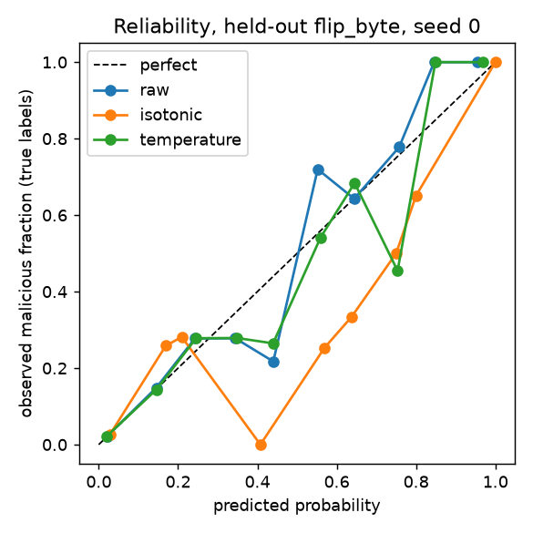

# SecureTrace: final report

Written for: researchers and reviewers who want to know what was built, what the evidence supports, and what it does not.

## Question

Can cryptographically verified integrity failures replace manual labels for adapting a network-intrusion model to a new network, and how do they compare with other ways of adapting?

SecureTrace puts hop-chained HMACs on a multi-hop transfer path. A failed check says "something changed on segment B between t1 and t2". That gives a weak, bag-level label and a tampered-segment location, which are used to adapt and focus an ML model. Everything runs in a synthetic Docker lab with an on-path attacker.

## What was built

| Part | Where |
|---|---|
| Hop-chained HMAC, signed events, hash-chained log, segment localization | `securetrace/integrity/`, `lab/collector/` |
| Docker lab: sender, two relays, receiver, on-path attacker (two mutators), benign noise, sensors (CICFlowMeter + Zeek) | `lab/` |
| Randomized session generator with true labels kept for evaluation only | `scripts/generate_lab_runs.py` |
| Public-data baselines (five model families) and the cross-dataset gap | `securetrace/models/`, `scripts/train.py` |
| Weak-label builder (bag-level, key/config errors excluded), session splits, label quality | `securetrace/data/` |
| Weak-label adaptation: naive, Elkan-Noto, nnPU, attention-MIL | `securetrace/adapt/` |
| Label-free comparators: anomaly detection, SCARF, CORAL, DANN | `securetrace/unsup/` |
| Calibration, alerting modes, TreeSHAP, fused alert | `securetrace/fusion/` |
| Interactive dashboard: four clickable panels, hop-chain "why this segment", per-flow TreeSHAP and counterfactuals, alert-mode comparison, calibration/label-quality/shuffled-label control views, live demo (real attack in the lab) and an offline tamper simulator | `dashboard/`, `securetrace/fusion/{explain,simulator,live,control}.py`; demo script in [docs/DEMO_SCRIPT.md](docs/DEMO_SCRIPT.md) |
| One-command rerun and verification | `scripts/run_all.py`, `scripts/verify_project.py`, `scripts/verify_end_to_end.py` |

## Results

Lab dataset: 100 sessions (52 tampered, 48 clean), split by session into 44 train, 15 validation and 41 test, with one attack type (mutator) held out of training. Both choices of held-out mutator are reported (`flip_byte` / `rewrite_size`). Metric is PR-AUC; the test attack rate is 0.175. Five seeds throughout; intervals are 95% t-intervals.

**Q1. The gap.** Models trained on public data score near chance on the lab: MLP 0.34 / 0.33, XGBoost 0.22, LightGBM 0.27 / 0.25, logistic regression 0.21, random forest 0.17.

**Q2. Weak labels close it.** Adapting with integrity-derived weak labels reaches 0.80 to 0.90. Shuffling the weak labels removes the gain in all 14 method arms over all 5 seeds.

| Method (flip_byte / rewrite_size held out) | PR-AUC |
|---|---|
| XGBoost, naive (unlabelled = negative) | 0.895 / 0.795 |
| XGBoost, Elkan-Noto PU | 0.879 / 0.796 |
| MLP, naive | 0.819 / 0.851 |
| MLP, attention-MIL | 0.686 / 0.638 |
| MLP, nnPU | 0.404 / 0.393 |

The PU and MIL methods did not beat the naive baseline. Here the weak labels are nearly complete (bag recall about 0.99, precision 0.68 to 0.87 depending on window width), so treating unlabelled flows as negative works. This is a result about this lab, not a general statement about PU learning. nnPU got worse as more tampered sessions were added, consistent with the Elkan-Noto estimator overestimating the class prior (it is biased low when positives overlap other flows).

**Q3. Label-free comparators.** Isolation forest 0.21 / 0.25, autoencoder 0.23 / 0.39, CORAL 0.20 / 0.21, SCARF encoder with public head 0.13 / 0.15, DANN 0.45 / 0.31 (best label-free but unstable, interval about +/-0.25). None reliably beats the unadapted public model. SCARF pretraining adds nothing to weak-label fine-tuning (difference +0.003 and -0.017, both within about +/-0.02).

**Q4. Localization and fusion.** The integrity layer attributed every tampered session to the true segment (52 of 52, 0 misattributions, 0 false calls on clean sessions). On 31 test incidents per split, irrelevant alerts per incident fell from about 1.0 to 1.3 (ML-only and time-window correlation) to about 0.10 (localized fusion) at the same recall (0.66 to 0.68). Precision@5 and @10 are about 1.0 in every mode, so they do not show the benefit. Isotonic calibration lowered ECE modestly (0.017 vs 0.028, and 0.033 vs 0.049), but the intervals overlap and an earlier, smaller run showed the opposite, so the calibration benefit is unproven.



An example fused alert, with the integrity evidence and TreeSHAP top features per flow, is in [docs/example_fused_alert.json](docs/example_fused_alert.json).

## Verification

`python scripts/verify_project.py`: 14 of 14 checks pass (see [docs/verification_report.md](docs/verification_report.md)): a one-byte payload flip fails verification; a tamper on segment k is attributed to k only; the event log detects a modified row; the weak-label builder excludes key and config errors; no identifier or timestamp columns in the features; no session in two splits (10 splits checked); the held-out attack is absent from training; weak labels do not change when ground truth is removed from the manifest; shuffled labels remove the gain; the true-label go/no-go model reaches 0.93 PR-AUC; a segment-only model scores at chance (0.105 vs 0.121); a logged result reproduces from its config to six decimals; the full test suite (115 tests) passes.

`python scripts/verify_end_to_end.py`: with the lab running, one forced tamper session was detected, localized to the right segment, served by the collector, and shown in the dashboard with a ranked fused alert.

## Limitations

- **Synthetic lab.** Traffic, noise and the attacker are generated by this project. Training and test sessions share the same lab, attacker implementation and noise generator. Nothing here shows the results carry over to a real network.
- **Enlarged footprint.** The first attacker was indistinguishable from benign traffic at the flow level (PR-AUC 0.21, chance). `rewrite_size` was deliberately enlarged and the tampered segment is re-segmented, so the attack is detectable by construction. `flip_byte` alone leaves little flow-level trace.
- **Small data.** 100 sessions, 41 test sessions, 31 incidents per split. Label-efficiency curves and several intervals are coarse. Several 40-session conclusions changed with 100 sessions (MIL improved, nnPU worsened, the ML-only false-alert count dropped from about 10 to about 1), so expect further movement with more data.
- **Evaluation labels.** "Irrelevant alert" and the true labels come from the attacker's own per-flow log.
- **Not done.** The optional sequence-model (GRU or transformer) stretch. Label-free comparators were not hyper-parameter tuned. The `shap` package is not installed; explanations use XGBoost's built-in exact TreeSHAP.
- **Novelty.** Weak-label adaptation (Novelty A) and localization-plus-fusion (Novelty B) are variants or combinations of prior work on PU learning, multiple-instance learning, and alert correlation. They are not claimed as first.

## Reproduce

```bash
docker compose --env-file .env -f lab/docker-compose.yml up -d --build
python scripts/generate_lab_runs.py --runs 60 --seed 47 --tamper-offset 25   # append sessions
python scripts/run_all.py                    # all lab-dependent experiments, in order
python scripts/build_dashboard_bundle.py && streamlit run dashboard/app.py
python scripts/verify_project.py && python scripts/verify_end_to_end.py
```

Public models are trained once with `python scripts/train.py --config configs/phase1_public_baseline.yaml --save-model`. Every experiment has a config in `configs/`, a fixed seed, and a run logged to the local MLflow store.
